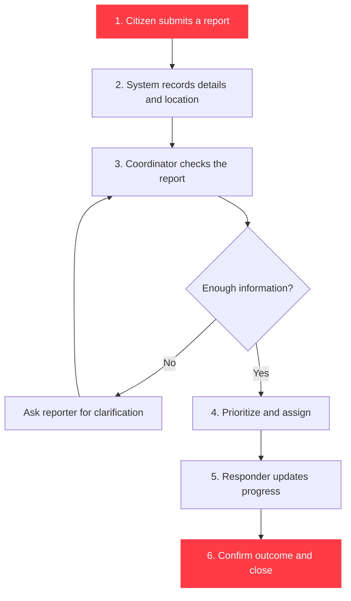
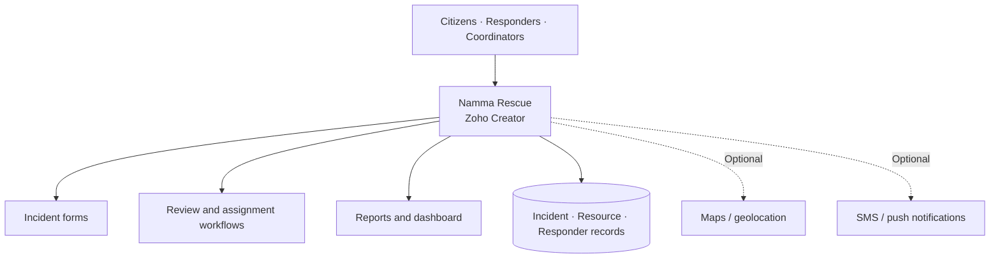
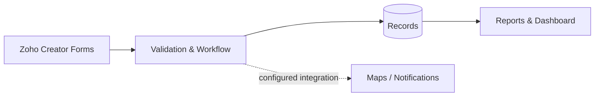

### Chennai's community-first emergency response platform

**Report incidents · Coordinate assistance · Track response**

---

## The problem

Chennai's flat terrain and monsoon rainfall can contribute to water stagnation and flooding. The Greater Chennai Corporation notes that the city's average land level is about **2 metres above mean sea level**. Residents may need to report a hazard, explain where help is needed, and find relevant support while conditions are changing.

**Namma Rescue proposes one coordinated workflow** for reporting incidents, reviewing requests, assigning responders, and tracking outcomes.

  

Context source: <a href="https://chennaicorporation.gov.in/gcc/department/storm-water/">Greater Chennai Corporation — Storm Water Drainage</a>.

## What it does

| Capability | How it helps |
|---|---|
| 🚨 **Emergency reporting** | Collects incident type, location, urgency, and assistance needed. |
| 📍 **Location capture** | Helps coordinators identify where an incident was reported. |
| 🌧️ **Flood & road reports** | Collects waterlogging and access-disruption reports for verification. |
| 🧑‍🚒 **Responder coordination** | Supports review, assignment, and status updates. |
| 🏥 **Resource directory** | Organizes hospital, shelter, and relief-centre information. |
| 📊 **Operations dashboard** | Summarizes open requests, priorities, assignments, and outcomes. |

## How the process works

### What happens at each step?

1. **Report:** The citizen selects an incident category, adds a short description, provides a location, and submits the request.
2. **Record:** The app creates an incident ID and stores the submission in its configured data source.
3. **Review:** An authorized coordinator checks the details, flags duplicates or unverified claims, and sets priority.
4. **Assign:** The coordinator selects an available, suitable responder or routes the request through the relevant official channel.
5. **Respond:** The responder records accepted, en-route, on-scene, or other configured status updates.
6. **Close:** The outcome and timestamps are recorded. Dashboard metrics update from the saved records.

*These are the intended operating steps. Automatic ID creation, notifications, map capture, assignment rules, and status transitions must be configured and tested in the actual Zoho Creator app.*

## A real-life Chennai scenario

**Illustrative scenario — not a report of a live incident.**

During heavy rain, a resident in **Velachery** reports that water is entering a ground-floor home and that an elderly neighbour needs assistance.

| Stage | Namma Rescue workflow | Practical benefit |
|---|---|---|
| 1 · Report | Resident selects **Flooding / Rescue**, enters the street or map location, and describes the need. | The request is more actionable than a vague message such as “flooding here.” |
| 2 · Record | A report ID, submission time, category, location, and status are saved. | The report can be referenced and duplicates can be checked. |
| 3 · Verify | Coordinator calls or messages to confirm the situation and immediate needs. | Unverified reports are not treated as confirmed facts. |
| 4 · Prioritize | A request involving immediate danger or a vulnerable person is escalated according to the response policy. | Urgency is considered rather than handling every report identically. |
| 5 · Coordinate | Coordinator contacts the appropriate authorized emergency service and, where appropriate, a verified local support team. | The request has a clear owner and next action. |
| 6 · Update | Status, contact attempts, assignment, and outcome are recorded. | Other coordinators can see progress without relying only on scattered chat messages. |

**Expected benefit:** clearer incident details, less ambiguity during handoffs, a traceable status history, and better visibility of unresolved requests. Namma Rescue does **not** guarantee a rescue, dispatch government vehicles automatically, or replace emergency call centres.

> **If someone is in immediate danger in India, call 112.** Use Namma Rescue as a coordination aid only; do not wait for an app response before contacting official emergency services.

## Chennai context: numbers that matter

These figures are **published context**, not Namma Rescue performance metrics:

- **~2 m:** Greater Chennai Corporation's stated average city land level above mean sea level.
- **345 km:** Storm-water drain length reported as completed under the JnNURM-funded core-city works on the Corporation's drainage page.
- **74 watersheds:** The Tamil Nadu Chennai Flood Monitoring / Decision Support System describes its modelling area as divided into 74 watersheds.
- **989 km of river length:** The same flood-monitoring system says its model covers this total river length.
- **112:** India's official unified emergency number for police, fire, medical, and other emergency assistance.

Sources: [Greater Chennai Corporation — Storm Water Drainage](https://chennaicorporation.gov.in/gcc/department/storm-water/), [Chennai Flood Monitoring & Decision Support System](https://chennaifloodmonitor.tn.gov.in/Master/AboutUs), and [Government of India's ERSS 112](https://112.gov.in/about).

*Infrastructure figures reflect what the linked public pages state; they are not a live progress feed. Namma Rescue does not own or operate these public systems.*

## How the application is organized

### Main records

- **Incident:** ID, category, description, reported location, priority, status, timestamps.
- **Responder:** identity or team reference, availability, permitted assignment, status updates.
- **Resource:** resource type, address, contact details, verification date, availability notes.
- **Audit history:** who changed a status, when it changed, and the recorded outcome.

Restrict personal data and precise incident locations to authorized users. Keep only the information needed for response and follow applicable privacy requirements.

## Dashboard: measure what is actually happening

The dashboard should calculate metrics from real records—not hard-coded sample numbers.

| Metric | Definition |
|---|---|
| Open incidents | Reports not yet resolved or closed |
| Awaiting review | Reports submitted but not yet reviewed |
| High-priority open | Open reports marked high priority by an authorized reviewer |
| Assignment time | Time from report submission to responder assignment |
| Resolution time | Time from report submission to recorded resolution |
| Area/category distribution | Counts grouped by neighbourhood and incident type |

Track median as well as average response times, and display the time window and record count. Do not claim the app reduces response time until a measured baseline and comparable post-deployment data support that conclusion.

## Technology

- **Zoho Creator:** forms, records, reports, role permissions, and configured workflows.
- **Deluge:** workflow automation where implemented.
- **Maps:** optional map or geolocation provider, requiring setup.
- **Notifications:** optional SMS or push integration, requiring setup and testing.
- **GitHub:** project documentation and version history.

## Roadmap

- [ ] Complete and test SOS and incident submission
- [ ] Add verified Chennai resource listings
- [ ] Configure review, priority, assignment, and closure workflows
- [ ] Add Tamil and English support
- [ ] Integrate trusted flood information where permitted
- [ ] Add notification delivery and audit history
- [ ] Measure response performance using real, timestamped records

## Safety and limitations

- A submitted report is **not automatically verified**.
- A map marker is not proof of a safe route, confirmed flood, or available rescue team.
- Do not publish victims' personal information or exact locations publicly.
- Any external data, notifications, or live tracking must be integrated, authorized, and tested.
- Namma Rescue is a proposed coordination tool, not an official emergency dispatch service.

## Getting started

1. Open the Namma Rescue app in Zoho Creator.
2. Configure incident categories, forms, required fields, permissions, and workflows.
3. Add verified resource records and test with clearly labelled dummy incidents.
4. Test report → review → assignment → update → closure end to end.
5. Confirm dashboards match the records and verify every integration before operational use.

> This README documents the project; it is not an importable Zoho Creator application package.

---

### NAMMA RESCUE

**Oru Chennai. Oru Network. Uyir Kaappom.**

*Built for clearer coordination and a safer Chennai.*

